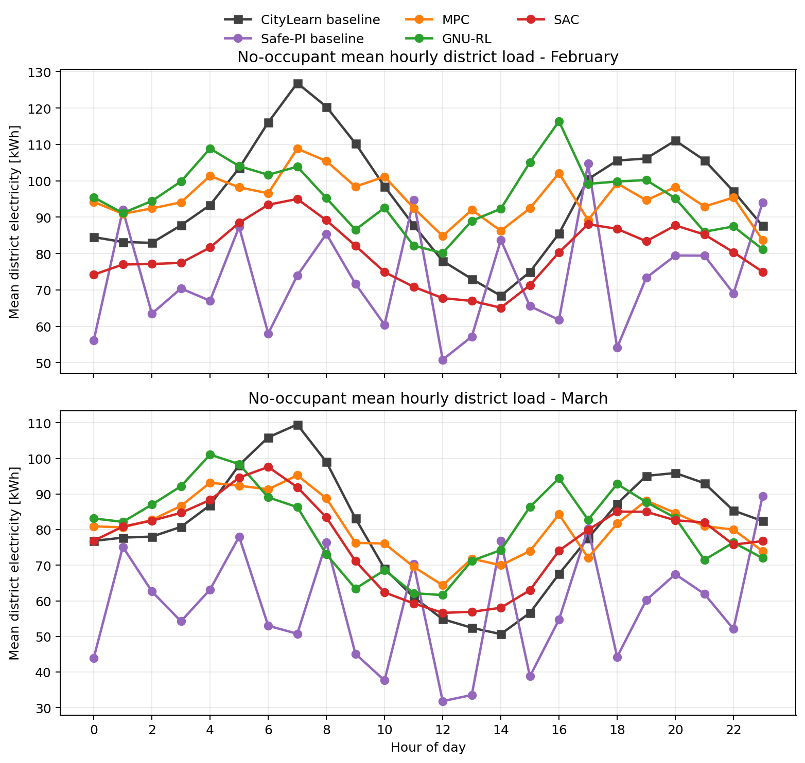

# Occupant-Centric Heat-Pump Control

Thesis benchmark for IEA EBC Annex 96 Common Exercise 1: heat-pump control in
25 Vermont homes using CityLearn. The study compares Safe-PI, SAC, MPC, and
GNU-RL under limited commissioning data and simulated occupant feedback.

**Start with the results:** the notebooks below contain the final thesis tables
and saved figures. They can be viewed directly on GitHub, and their cells run
from the included exports without training a controller.

| Notebook | What you will find |
|---|---|
| [Controller comparison](analysis/01_no_occupant_results.ipynb) | Tables VII–VIII: February/March portfolio KPIs, representative buildings, and model-adaptation diagnostics. |
| [Occupant feedback](analysis/02_occupant_results.ipynb) | Table IX: four occupant types, dynamic references, thermostat overrides, and comfort profiles. |
| [Load shifting](analysis/03_load_shifting_results.ipynb) | Daily demand profiles, reference-bias windows, and deployment KPI trajectories. |
| [Occupancy validation](analysis/09_bspline_occupancy_validation.ipynb) | B-spline forecasts, January-only holdout evaluation, and persistence comparison. Requires the simulation environment to rerun. |



## Main findings

January supplies commissioning data. Controllers deploy in February, then use
February data for SAC continuation and GNU-RL adaptation before March.

| Controller | February discomfort | March discomfort | Model / training |
|---|---:|---:|---|
| Safe-PI/RBC | 41.71% | 34.18% | PI with safety limits |
| MPC | **1.10%** | **1.17%** | Fitted 2R2C model with Kalman correction |
| GNU-RL | 3.94% | 3.75% | Differentiable 1R1C MPC with online adaptation |
| SAC | 27.09% | 5.70% | January learning, then February continuation |

These are mean building-level no-occupant results from thesis Table VII.
MPC preserves comfort most reliably among the tested controllers. SAC improves
substantially with continuation data. Lower electricity consumption must be
read alongside comfort: an underheating controller can appear energy-efficient.

With simulated occupants, the B-spline dynamic reference reduces thermostat
override pressure, with performance depending on occupant type and building.
The thesis reports approximately 78% override reduction for MPC and 72% for
GNU-RL. The [occupant notebook](analysis/02_occupant_results.ipynb) includes the
paired building-level counts and explains the auxiliary comfort indicators.

## Read or reproduce

To open and rerun the three final-results notebooks:

```bash
python -m pip install -r requirements-analysis.txt
jupyter lab analysis/01_no_occupant_results.ipynb
```

To rebuild all three notebooks and refresh their saved outputs:

```bash
python scripts/build_results_notebooks.py --execute
```

Full controller training requires the local CityLearn implementation, simulation
dependencies, and commissioning/model artifacts. See the
[reproduction guide](docs/reproduction.md) for the stages and limitations;
[the scripts guide](scripts/README.md) identifies each entry point.

## Repository map

| Directory | Purpose |
|---|---|
| [`analysis/`](analysis/README.md) | Final reading notebooks, published tables, figures, and provenance manifest. |
| [`scripts/`](scripts/README.md) | Benchmark collection, fitting, training, deployment, and result presentation. |
| [`src/`](src/) | Reusable models, controllers, occupant logic, rewards, and evaluation. |
| [`configs/`](configs/) | Building, controller, and scenario configuration. |
| [`experiments/`](experiments/README.md) | Research history: reward ablations, trial runs, scratch notebooks, and original publication exporters. |
| [`notebooks/`](notebooks/README.md) | Original CE1 onboarding tutorial. |
| [`citylearn/`](citylearn/) | Project's local CityLearn implementation. |
| [`diff_mpc/`](diff_mpc/) / [`Gnu-RL/`](Gnu-RL/) | Differentiable MPC implementation and upstream GNU-RL reference. |
| `results/` | Local generated trajectories, agents, fitted models, and replay buffers; excluded from Git. |

Historical notebooks retain their saved outputs under `experiments/`. Earlier
sections called “final” represent intermediate research milestones; the three
reading notebooks above identify the final thesis result set explicitly.

The occupant models are controlled simulation components. The work does not
establish field performance with real thermostat users. The original license
and upstream attribution remain in [LICENSE](LICENSE) and the bundled projects.
